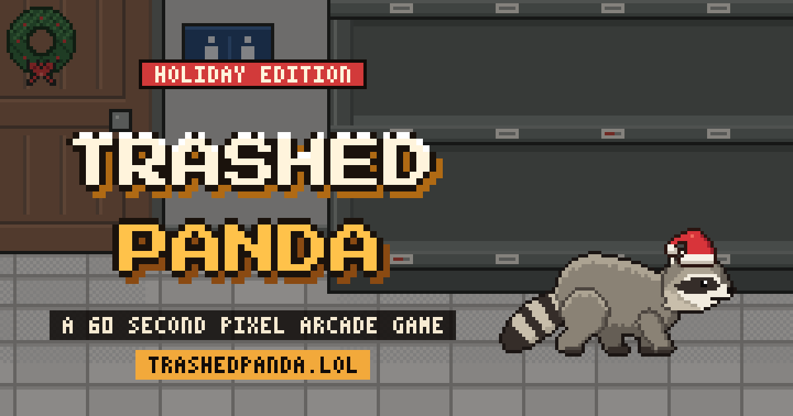

# Trashed Panda



**[Play it at trashedpanda.lol](https://www.trashedpanda.lol)**: a 60-second pixel-art arcade game based on
the true story of the raccoon who fell through the ceiling of the Ashland, VA ABC store on
Thanksgiving weekend 2025, smashed the shelves, and passed out in the bathroom.
This is the **Holiday Edition**.

## What's here

| | |
| --- | --- |
| `index.html` | Home page: hero and the true story |
| `play/` | The game, on its own full-screen page (no scrolling or zooming on phones, installable to the home screen via `manifest.webmanifest`) |
| `js/game/` | Game engine: simulation, canvas renderer, synthesized audio, input, UI |
| `css/` | Shared pixel design system (`site.css`) and page styles |
| `assets/` | Generated sprites, UI art and fonts |
| `tools/` | Python pipeline that generates every image from the source art (not deployed) |

No build step and no dependencies: it's static HTML, CSS and ES modules, served as-is by
GitHub Pages.

## Run it locally

ES modules need a web server (opening the file directly won't work):

```bash
python3 -m http.server 8000
```

Then visit <http://localhost:8000> (the game itself is at <http://localhost:8000/play/>).

## How to play

* **Move:** ← → or A D. **Climb:** ↑ ↓ or W S (hold to keep climbing)
* **Swipe / drink:** Space or E. Swipe bottles off a shelf, drink the puddles on the floor.
* Smash bottles back to back for a **combo** (up to x3).
* Drinking raises your **buzz**, which multiplies every point (up to x3). Hit 100% and you
  black out for three seconds.
* Smash a **Holiday Reserve** bottle for +5 seconds. Emptied shelves restock.
* On phones: D-pad plus a context-sensitive paw button. Each sits in a large touch zone,
  so a thumb that lands near (not exactly on) a button still counts. Portrait play uses a
  HUD strip on top and the controls on a strip below, so nothing covers the shelves.
* **P** or **Esc** pauses, **M** mutes, **F** goes full screen.

## Regenerating the art

Every image in `assets/` is generated by a small Pillow pipeline in `tools/`.

* **The raccoon is drawn from scratch by `tools/raccoon.py`.** The heads are hand-placed pixel
  art; the body, limbs and ringed tail are built from a few shapes and shaded on one fixed
  palette. That one file renders the game's sprite sheet, the nav face and favicon, the
  passed-out scene and the 404 art, so the character is the same everywhere. To change
  how the raccoon looks, change it there and rebuild.

```bash
pip install pillow numpy
bash tools/build_all.sh
```

## Credits

Game, art direction and story adaptation by Dylan Hughes ([dylanhughes.dev](https://dylanhughes.dev)).
Fonts: Press Start 2P (CodeMan38) and Pixelify Sans (Stefie Justprince), both under the SIL Open
Font License (see `assets/fonts/OFL.txt`). Music: chiptune arrangements of public-domain carols
("Jingle Bells", "Carol of the Bells"), synthesized live in the browser.

Trashed Panda is a fan project and is not affiliated with Virginia ABC or Hanover County.
